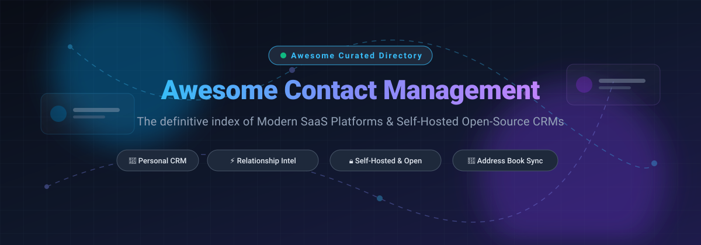

  

# 📇 Awesome Contact Management Software

  
  
  
  
  
  
  

> 🌟 A curated collection of top **Contact Management Software**, **Personal CRM**, and **Address Book** solutions — featuring both enterprise SaaS platforms and privacy-first, self-hosted open-source GitHub projects.

Contact management tools empower professionals, sales teams, and relationship builders to organize interaction histories, log communications, sync address books across devices, track follow-up cadences, and enrich contact records.

---

## 📑 Table of Contents
- [📊 Sector Overview & Market Dynamics](#-sector-overview--market-dynamics)
- [☁️ SaaS & Hosted Platforms](#️-saas--hosted-platforms)
- [💻 Open-Source GitHub Projects](#-open-source-github-projects)
- [⚖️ How to Choose: SaaS vs Open Source](#️-how-to-choose-saas-vs-open-source)
- [📈 Star History](#-star-history)
- [💖 Support](#-support)
- [🤝 How to Contribute](#-how-to-contribute)
- [📜 License & Disclaimer](#-license--disclaimer)

---

## 📊 Sector Overview & Market Dynamics

The global contact management software sector is estimated at **$2.7B – $9.2B** (scaling upwards of **$80B – $110B+** when evaluated within the broader Customer Relationship Management (CRM) domain), maintaining a 7%–12% CAGR driven by automated data enrichment, omnichannel inbox sync, and AI relationship intelligence. The market structure is **highly fragmented**: while established tech giants (Google, HubSpot, Zoho, Salesforce) anchor high-volume enterprise deployments, no single vendor captures a winner-take-all monopoly—leaving significant market share distributed across agile vertical CRMs, lightweight digital rolodexes, and privacy-respecting self-hosted open-source stacks.

---

## ☁️ SaaS & Hosted Platforms

| Product | 🏢 Valuation / Revenue | 💵 Starting Price | 🎁 Free Tier / Trial Limits | 📝 Description |
|---|---|---|---|---|
| **[Google Contacts](https://contacts.google.com/)** | Alphabet: ~$2.1T+ Market Cap / ~$350B+ ARR | $7.00/user/month (via Google Workspace) | **Free forever**: 100% free with unlimited contacts (up to 25,000 personal contacts) on personal Google accounts. Workspace plans start from $7/user/month. | Cloud-native contact management and address book natively synchronized across Android, Gmail, and Google Workspace ecosystems. |
| **[HubSpot CRM](https://www.hubspot.com/)** | ~$30B+ Market Cap / ~$2.5B+ ARR | $15.00/user/month (annual billing) | **Free forever plan**: Up to 1,000,000 contacts and 1 user seat with deal pipelines, forms, and email tracking. Paid tiers provide a **14-day free trial** (no credit card required). | Inbound CRM suite offering contact timeline tracking, meeting scheduling, email logging, and marketing automation. |
| **[Zoho ContactManager](https://www.zoho.com/contactmanager/)** | Zoho Corp: ~$1B+ ARR (Bootstrapped) | $7.00/user/month (Single User plan) | **Free forever edition**: Up to 1 user, 500 contacts, and 10 deals. Paid plans include a **15-day free trial** with full feature access. | Focused contact management with deal pipelines, business card scanning, and Microsoft 365 / Mailchimp integrations. |
| **[Follow Up Boss](https://www.followupboss.com/)** | Zillow Group: ~$400M–$500M Acquisition / ~$25M ARR | $69.00/user/month (Grow tier) | **14-day free trial**: Full platform access for unlimited contacts, call/text logging, and lead routing (no credit card required). No permanent free tier. | Real estate relationship management system with instant lead routing, phone integration, and team collaboration. |
| **[Insightly](https://www.insightly.com/)** | ~$37M ARR / ~$38M Total Funding | $29.00/user/month (Plus plan, annual) | **14-day free trial**: Access to Plus tier features with lead routing and milestone tracking. No permanent free tier. | Contact and relationship management paired with integrated project delivery pipelines and workflow automation. |
| **[Capsule CRM](https://capsulecrm.com/)** | ~$7M ARR (Zestia Ltd) | $18.00/user/month (Starter tier, annual) | **Free forever plan**: Up to 2 users, 250 contacts, and 50MB storage. Paid tiers offer a **14-day free trial** (no credit card required). | Lightweight, user-friendly CRM and contact organizer built for small businesses and consultancies. |
| **[Nimble](https://www.nimble.com/)** | ~$5M ARR / Bootstrapped & Seed | $24.90/user/month (annual billing) | **14-day free trial**: Full access up to 5 user licenses with contact enrichment and email tracking (no credit card required). No permanent free tier. | Social relationship management platform providing automated contact profile enrichment and inbox synchronization. |
| **[Cloze](https://www.cloze.com/)** | ~$1M ARR | $17.00/user/month (Cloze Pro) | **Free forever plan**: Basic contact management, email inbox, and interaction history. Pro/Business tiers provide a **14-day free trial** (no credit card required). | AI-driven relationship manager that automatically syncs email, call records, and calendar events into customer timelines. |
| **[Covve](https://covve.com/)** | ~$5M Total Funding / ~$200K ARR | $12.00/seat/month ($119 billed annually) | **14-day free trial**: Full access to AI business card scanning and relationship reminders. No permanent free tier (scanned contacts remain accessible). | Mobile-first personal CRM and networking assistant featuring AI business card recognition and automated follow-up cadences. |

---

## 💻 Open-Source GitHub Projects

Curated self-hosted contact managers, open-source personal CRMs, CardDAV address books, and ERP contact engines. Ranked by GitHub stargazer count:

| Project | ⭐ GitHub_Stars | 🛠️ Technology Stack | 📝 Description |
|---|---|---|---|
| **[Twenty](https://github.com/twentyhq/twenty)** |  | TypeScript, React, NestJS, PostgreSQL | Modern open-source CRM alternative to Salesforce with contact management, custom relational objects, and visual pipelines. |
| **[Odoo](https://github.com/odoo/odoo)** |  | Python, JavaScript, PostgreSQL | Comprehensive open-source ERP platform featuring dedicated contact and CRM modules, lead scoring, and communication tracking. |
| **[Monica](https://github.com/monicahq/monica)** |  | PHP, Laravel, Vue.js, MySQL | Celebrated open-source personal CRM engineered to record personal relationships, significant dates, conversations, gifts, and notes. |
| **[Roundcube Webmail](https://github.com/roundcube/roundcubemail)** |  | PHP, JavaScript, MySQL/SQLite | Browser-based multilingual email client featuring a full-featured LDAP and CardDAV contact management and address book engine. |
| **[GLPI](https://github.com/glpi-project/glpi)** |  | PHP, MariaDB/MySQL | Open-source asset, service management, and CRM tool featuring centralized directory contacts, supplier records, and relationship mapping. |
| **[SuiteCRM](https://github.com/SuiteCRM/SuiteCRM)** |  | PHP, Symfony, MariaDB | Enterprise-grade open-source CRM with granular contact management, account histories, workflow automations, and reporting. |
| **[Radicale](https://github.com/Kozea/Radicale)** |  | Python | Lightweight, privacy-focused CalDAV and CardDAV address book server for cross-device contact synchronization. |
| **[EspoCRM](https://github.com/espocrm/espocrm)** |  | PHP, Backbone.js, MySQL | Fast and responsive single-page open-source CRM for managing contact records, sales leads, companies, and email threads. |
| **[Corteza](https://github.com/cortezaproject/corteza)** |  | Go, Vue.js, PostgreSQL | Low-code enterprise platform and open-source Salesforce alternative featuring customizable contact and account management apps. |
| **[vdirsyncer](https://github.com/pimutils/vdirsyncer)** |  | Python | Command-line utility to synchronize CardDAV address books and CalDAV calendars between servers and local directories. |
| **[Cypht](https://github.com/cypht-org/cypht)** |  | PHP, JavaScript | Lightweight webmail and feed aggregator with integrated CardDAV address books and personal contact tracking. |
| **[Nextcloud Contacts](https://github.com/nextcloud/contacts)** |  | Vue.js, PHP | Official Nextcloud address book application for private, self-hosted contact management synced via standard CardDAV. |

---

## ⚖️ How to Choose: SaaS vs Open Source

- **Choose SaaS Platforms** when you require instant onboarding, out-of-the-box email/calendar synchronizations (Google Workspace, Office 365), automated contact data enrichment, mobile apps with AI business card scanners, and zero server maintenance overhead.
- **Choose Open-Source Solutions** when data privacy, sovereignty (GDPR/HIPAA compliance), offline access, and zero per-seat licensing costs are essential. Open-source platforms like **Twenty**, **EspoCRM**, or **Monica** run cleanly under Docker Compose with PostgreSQL or MySQL backends.

---

## 📈 Star History

---

## 💖 Support

Thank you for exploring this curated guide to Contact Management Software! If you found this repository valuable, please consider supporting the project:

- ⭐ **Star this repository** to help others discover it on GitHub.
- 🍴 **Fork and share** it with colleagues, developers, and CRM specialists.
- ☕ **Sponsor or buy a coffee** to support continuous updates and curation: [**GitHub Sponsors Dashboard**](https://github.com/sponsors/ishandutta2007).

Every bit of support helps keep this index factual, unbiased, and continuously maintained!

---

## 🤝 How to Contribute

1. Fork this repository.
2. Add your suggested tool or framework in the appropriate category table in descending order of GitHub_Stars or market scale.
3. Ensure all links point to authoritative sources and detail accurate pricing or GitHub repositories.
4. Open a pull request with a concise description of why the tool belongs in this curated list.

---

## 📜 License & Disclaimer

- Distributed under the [MIT License](LICENSE).
- This repository is a community-curated research directory and is not affiliated with or endorsed by any software vendor listed.
- All product names, logos, and brands are property of their respective owners.
